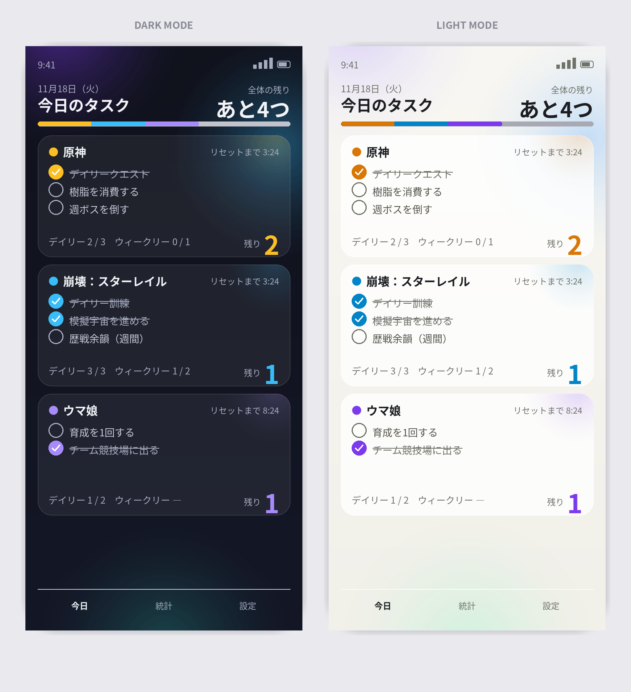
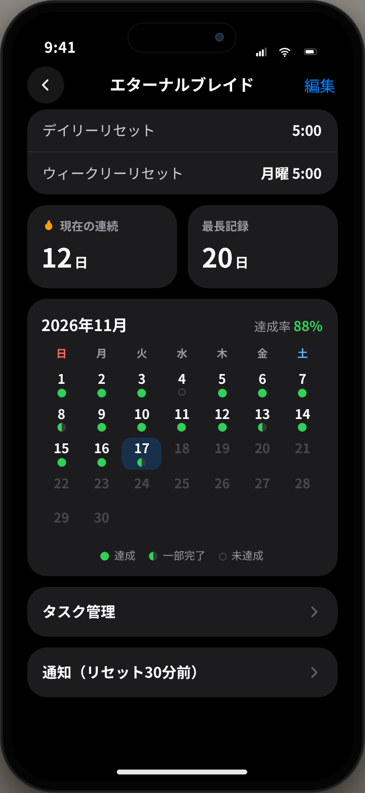

# DailyTasksGame

ゲームごとにデイリー／ウィークリータスクを管理するiOSアプリです（個人開発・開発中）。

ゲームによって違う「1日の区切り」（リセット時刻）をゲームごとに設定でき、今日やることと完了状況を1つの画面で確認できます。

## 主な機能

- ゲームの登録・編集（名前、テーマカラー10色、メモ）
- タスク管理（デイリー／ウィークリー、ゲームごとに登録）
- ゲームごとのリセット時刻（日次・週次）に対応した「ゲーム日」の自動判定
- 今日画面：全ゲームの残りタスク数と完了状況をまとめて表示
- 完了記録の保存・取り消し（期間が切り替わると表示も自動で切り替わります）
- データは端末内に保存

## 画面イメージ（完成予想図）





※完成予想図（デザイン案）です。実装中の画面とは異なる場合があります。

## ドキュメント

仕様と開発記録は [docs/](docs/) にまとめています。

- [クイックガイド](docs/00_クイックガイド.md)
- [要件定義](docs/02_要件定義.md)
- [仕様書](docs/03_仕様書.md)
- [開発ロードマップ](docs/05_開発ロードマップ.md)
- [進捗記録](docs/07_進捗記録.md)

## 開発環境

- Swift / SwiftUI
- Xcode（プロジェクトを開いてビルド）
- 計算ロジックはローカルSwiftパッケージ `Packages/AppCore` に分離し、単体テストを用意しています

テストの実行：

```sh
scripts/verify.sh
```

## 開発状況

- Phase 1（基盤：ゲーム・タスクの登録と保存）完了
- Phase 2（ゲーム日判定と今日画面）完了
- Phase 3（ストリークとゲーム詳細）開発中

今後、通知、ウィジェット、統計、画像による記録などを順次追加予定です。

## 開発について

個人開発の学習プロジェクトです。仕様書を作成したうえで、AI支援ツールも活用しながら開発しています。コードの理解を深めるため、担当した部分を中心に読み解きと検証を行っています。
